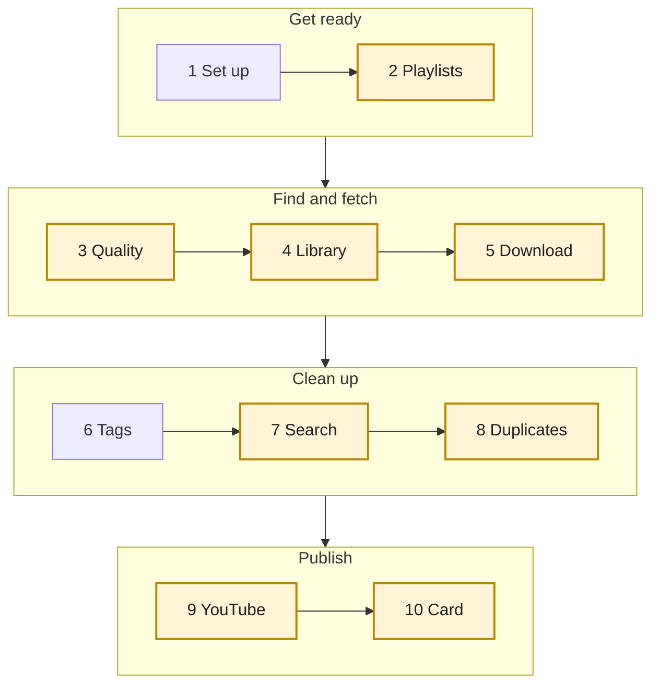
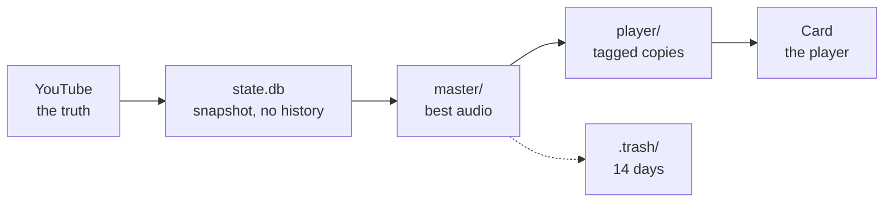

# runsync

Mirror your YouTube playlists to a microSD-based MP3 player (Shanling M0 Pro) with clean tags, cover art and no phone.
**The playlist is the source of truth**, the Mac library is the cache, the card is a disposable mirror.
Design and decisions: [DESIGN.md](DESIGN.md). Handling secrets: [SECURITY.md](SECURITY.md).

## What you need

A Mac, [Claude Code](https://claude.com/claude-code) (it is the interface: you talk to it, it runs runsync), a YouTube
account, and the player's microSD card. YouTube Premium is optional: with it songs download at ~258 kbps, without at ~130.

## Setup

```
brew install python uv ffmpeg chromaprint deno
git clone https://github.com/mohitjain/runsync && cd runsync && uv sync
```

Open Claude Code in the folder and say **"set up runsync"**. It checks the tools, walks you through the cookie file
(`cookies.txt`, gitignored: it works like your login, never share it) and offers the YouTube login below.

**YouTube login (optional, recommended).** Your playlists are then read through the official API, so stale cookies stop
mattering for them (Liked Music is the exception: only cookies can read it), and runsync can tidy your playlists. Create a Google Cloud project with the YouTube Data API v3, a
consent screen (add yourself as a test user) and a **Desktop** OAuth client; save its JSON as `client_secret.json`
(gitignored), then run `uv run runsync youtube --login`. While the Google app is in testing mode the login can expire after
7 days: run `--login` again.

## A normal run

Say **"sync my music"**. runsync works through the steps below and shows a small table after each, so you always know what
happened. **Yellow steps ask you first; nothing changes without your yes.**



Anything that changes YouTube, deletes a file or writes to the card follows the same four beats: **preview, you
confirm that exact plan, apply, read back and check.** Details for each step are below.

Where your music lives:



What each step does:

1. **Set up**: checks the tools, the project and your cookie file (the setup skill fixes what is missing).
2. **Playlists**: reads them from YouTube and asks only if you want to change which ones sync.
3. **Quality**: songs stuck at ~128 kbps get a gentle search for a better upload of the same recording (never songs already at 256 kbps; a miss is retried after a month). Finds are added to your library by the plan in the next step, and the duplicate step keeps the better copy.
4. **Library**: Liked Music is mirrored into one playlist you choose (the first run asks which, or creates one), because YouTube does not let apps edit likes but does let them edit a playlist. A new like is added to it, an unlike is removed, and the library list is what gets synced. Repeats, dead songs and replacements are handled in the same plan.
5. **Download**: new songs only; says how many are waiting and asks how many to fetch now.
6. **Tags**: clean artist, title, album, year, language and cover; builds the player copies.
7. **Search**: web-searches anything the code could not settle.
8. **Duplicates**: the same song uploaded twice; keeps the best by its audio, asks about doubtful pairs.
9. **YouTube**: removes the losing uploads from your playlists; shows every song it changes and checks the result on YouTube.
10. **Card**: copies the music to the player; you confirm the plan first.

You can stop after any step; the next run picks up where it stopped. While a long download runs, say "status".

## Use one piece at a time

| Say | Skill | Does |
|---|---|---|
| "sync my music" | `runsync` | the whole run above |
| "choose playlists" | `runsync-playlists` | pick which playlists to sync |
| "enrich my library" | `runsync-enrich` | web-searches what the code could not settle |
| "status" | `runsync-status` | progress; `/loop 5m /runsync-status` during a long download |
| "remove duplicates" | `runsync-dedupe` | the same song twice: keeps the best, asks about doubtful pairs |
| "sync to the card" | `runsync-sync-card` | registers the card once, previews, writes only the plan you confirm |
| "clean my YouTube playlists" | `runsync-youtube` | mirrors Liked Music into your library list, brings your playlists up to date, shows every song and checks the result |
| "replace the unavailable songs" | `runsync-replace` | finds new uploads of lost songs; your picks go in place of the dead entries; dead songs with no replacement are deleted |
| "add this song to Running" | `runsync-add` | search, pick, confirm, add |
| "improve the audio quality" | `runsync-quality` | finds better-sounding uploads for songs stuck at ~128 kbps (a few at a time, gently) and queues them for the next YouTube plan |

## When something goes wrong

| You see | What it means | Do this |
|---|---|---|
| "YouTube invalidated your cookies", or Liked Music "could not be read" / "playlist does not exist" | cookies rotate; removals pause until Liked Music can be read | re-export `cookies.txt` (the setup skill shows how) |
| "Your YouTube login expired" | the Google app is in testing mode (7 days) | `uv run runsync youtube --login` |
| "quota for today is used up" | Google allows 10,000 units a day | nothing is lost; it resets at midnight Pacific and the message says in how many hours |
| "Not confirmed. --apply needs --confirm …" | a plan changed since you confirmed it | look at the new plan and confirm again |
| a playlist "no longer exists on YouTube" | you deleted it but it still syncs | `uv run runsync playlists --stop "<name>"` |
| "No registered card is inserted" | the card isn't mounted or isn't registered | insert it, then "sync to the card" |
| something looks wrong after a push | | "undo" in `runsync-youtube` (until the next sync) |

## Safety

- A failed, empty or partial fetch never deletes anything; removed tracks go to `.trash/` for 14 days.
- Anything destructive or outward (dedupe delete, card sync, YouTube changes) shows a preview first and needs `--confirm <plan id>` of that exact plan; changes are journalled and undoable where possible.
- `state.db` is a snapshot of YouTube from the last sync plus changes still to push; once a push is checked on YouTube, dead rows (unavailable, merged, trashed) are deleted. No history is kept. Before a schema change a copy is kept as `state.db.pre-migration`.
- The card is identified by volume UUID; only files runsync put there are ever removed.
- Secrets (`cookies.txt`, `client_secret.json`, `youtube_token.json`, `*.db`, logs) are gitignored and blocked by a pre-commit and CI guard.

## Development

```
uv run pytest && uv run ruff check . && python3 scripts/check_sensitive.py --all
```

The skills drive `uv run runsync <command>` (`playlists`, `sync`, `resolve`, `status`, `dedupe`, `card`, `youtube`; most take
`--json`, which is what the skills read); `uv run runsync --help` lists them. The library lives in `~/Music/RunSync`
(`RUNSYNC_HOME` overrides it). Tests use a temp dir, never see your cookies or login, and cannot reach Google.

## License

See [LICENSE](LICENSE). Downloading with yt-dlp is outside YouTube's terms even with Premium; using it is your decision.
